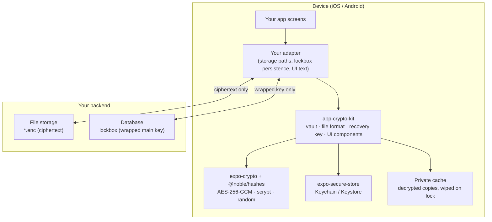
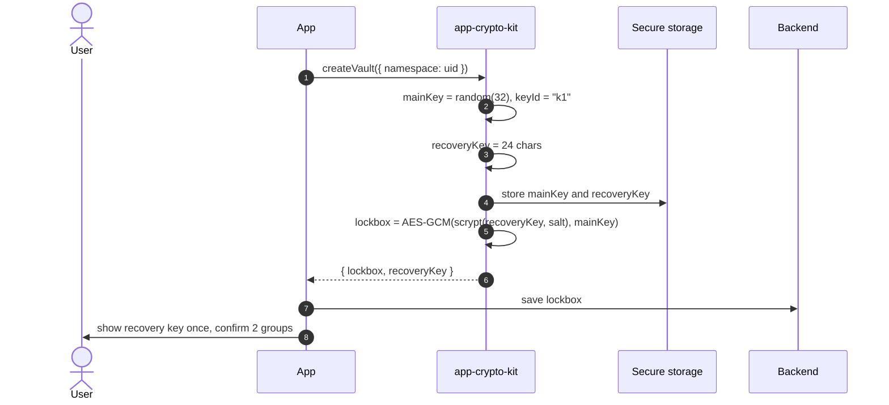
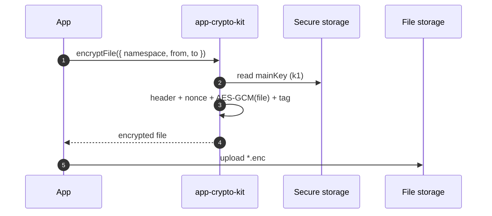
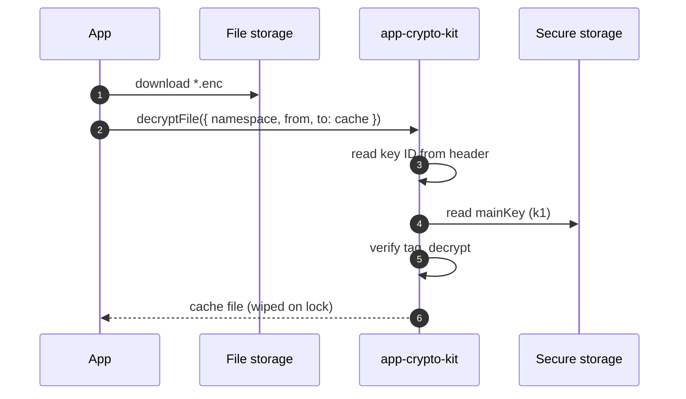
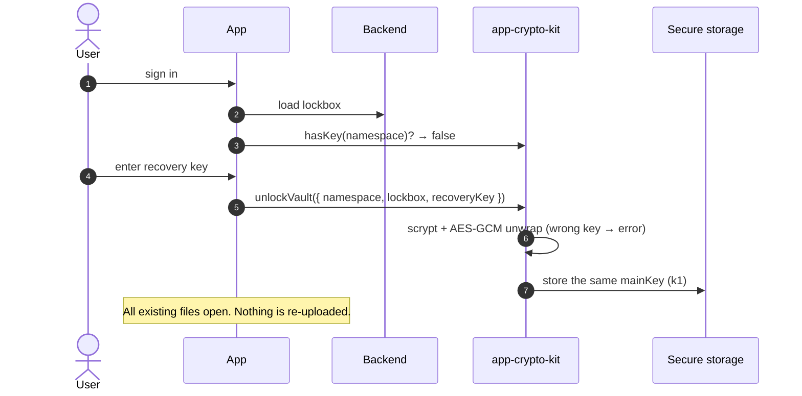
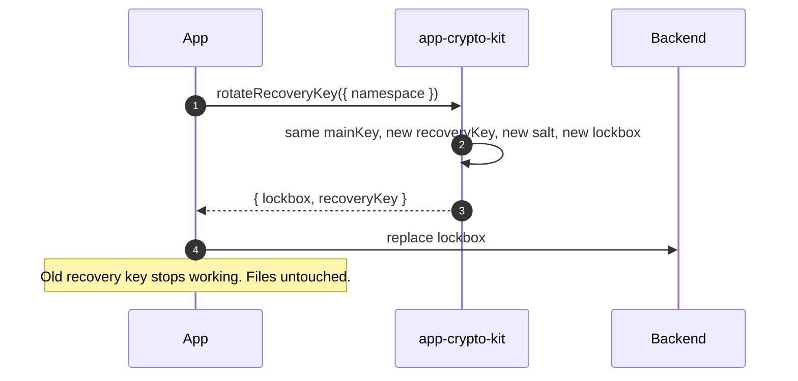
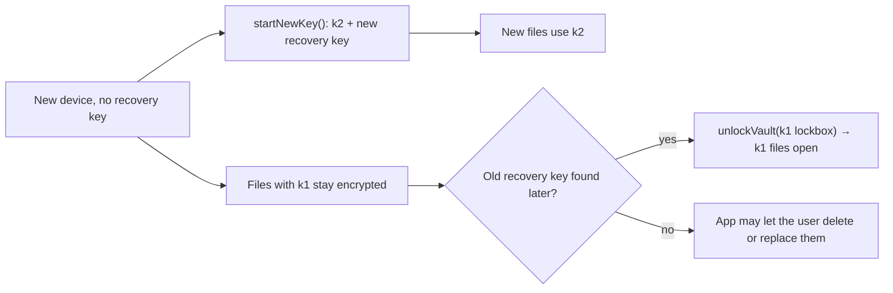

# app-crypto-kit

End-to-end file encryption for Expo apps. One codebase for **iOS and Android**.

Files are encrypted on the device before upload. The server stores only ciphertext and a wrapped key, so neither the backend nor the app owner can read user files.

| | |
|---|---|
| Cipher | AES-256-GCM (authenticated) |
| Key derivation | scrypt (N=2^14, r=8, p=1, `@noble/hashes`), parameters stored in each lockbox |
| Key storage | iOS Keychain (this device only) / Android Keystore via `expo-secure-store` |
| Crypto engine | `expo-crypto` native AES-GCM (CommonCrypto on iOS, javax.crypto on Android) |
| Recovery | 24-character recovery key, ~120 bits of entropy |
| Platforms | iOS, Android. No extra native module beyond Expo's own `expo-crypto`, `expo-secure-store`, `expo-file-system` |

---

## Contents

1. [Concepts](#concepts)
2. [Architecture](#architecture)
3. [Flows](#flows)
4. [Data formats](#data-formats)
5. [API](#api)
6. [Integration guide](#integration-guide)
7. [Security model](#security-model)
8. [FAQ](#faq)

---

## Concepts

| Term | Meaning | Where it lives |
|---|---|---|
| **Main key** | Random 256-bit key that encrypts every file for one user. Never changes. | Device secure storage only |
| **Recovery key** | 6 groups of 4 characters (alphabet `23456789ABCDEFGHJKLMNPQRSTUVWXYZ`, 120 random bits) (e.g. `K7QM-RW2D-HP4X-T9NB-ZC3F-LV8J`). Shown to the user once. | User (paper / password manager) and device secure storage |
| **Lockbox** | The main key, encrypted with a key derived from the recovery key. Safe to store in the cloud. | Your backend (the kit never talks to a server) |
| **Key ID** | Short label (`k1`, `k2` …) written into every encrypted file, so the right key is always used. | File header, lockbox, secure-storage name |
| **Namespace** | Your user ID. Keeps keys of different accounts on one device apart. | Secure-storage names |

**Rule of thumb:** the cloud holds the *locked box*; only the *recovery key* opens it; only the *main key* opens files.

---

## Architecture



**What the kit does:** key lifecycle, encryption, file format, recovery key, optional UI.
**What your app does:** where files and the lockbox are stored, when to encrypt and decrypt, all user-facing text and colours.

---

## Flows

### 1. First sign-in: create the vault



### 2. Add a file



### 3. View a file



### 4. New device (iOS or Android)



### 5. Reset recovery key



### 6. Recovery key lost on a new device



The app should keep the k1 lockbox until the user deletes the old files.

---

## Data formats

### Encrypted file (v1)

| Bytes | Field | Notes |
|---|---|---|
| 4 | Magic | `ACK1` |
| 1 | Key ID length *n* | |
| *n* | Key ID | UTF-8, e.g. `k1` |
| 12 | Nonce | Random per file |
| … | Ciphertext | |
| 16 | GCM tag | Detects any change |

The header (magic + key ID) is authenticated as GCM additional data, so the key ID can't be swapped.

### Lockbox

```json
{
  "v": 1,
  "keyId": "k1",
  "kdf": { "name": "scrypt", "N": 32768, "r": 8, "p": 1, "salt": "<base64, 16 bytes>" },
  "wrapped": "<base64: nonce | ciphertext | tag>",
  "createdAt": "2026-11-18T23:00:00Z"
}
```

### Secure-storage entries

| Name | Value |
|---|---|
| `crypto.mainKey.{namespace}.{keyId}` | Main key |
| `crypto.recoveryKey.{namespace}` | Recovery key (for "View recovery key") |
| `crypto.activeKeyId.{namespace}` | Key ID used for new files |

Stored with `AFTER_FIRST_UNLOCK_THIS_DEVICE_ONLY` (readable after the phone's first unlock so background work can run; never synced to iCloud Keychain or restored to another device). The list of key ids is kept under `crypto.keyIds.{namespace}`.

---

## API

```ts
import {
  createVault, unlockVault, startNewKey, rotateRecoveryKey,
  activeKeyId, hasKey, keyIds, getRecoveryKey,
  encryptBytes, decryptBytes, encryptFile, decryptFile, isEncryptedFile, clearFolder,
  clearMemory, forgetKeys,
  WrongRecoveryKeyError, MissingKeyError, TamperedDataError, NotEncryptedError,
} from 'app-crypto-kit';
```

| Function | Use |
|---|---|
| `createVault({ namespace })` → `{ lockbox, recoveryKey, keyId }` | First device. Save the lockbox, show the recovery key once. Throws if this device already has a vault. |
| `unlockVault({ namespace, lockbox, recoveryKey })` → `{ keyId }` | New device. Throws `WrongRecoveryKeyError`. Typing is forgiving (case, spaces, dashes). |
| `rotateRecoveryKey({ namespace })` → `{ lockbox, recoveryKey, keyId }` | Same main key, new recovery key. Replace the stored lockbox. |
| `startNewKey({ namespace, existingKeyIds })` → `{ lockbox, recoveryKey, keyId }` | Recovery key lost: new key (`k2`, `k3` …) for new data. Keep the old lockboxes. |
| `activeKeyId({ namespace })` | Key used for new data on this device, or `null`. |
| `hasKey({ namespace, keyId? })` | Whether this device holds a key. |
| `keyIds({ namespace })` | Key ids on this device. |
| `getRecoveryKey({ namespace, keyId? })` | Formatted recovery key for "View recovery key" screens. |
| `encryptBytes` / `decryptBytes({ namespace, data })` | In-memory data. |
| `encryptFile` / `decryptFile({ namespace, from, to })` | File URIs (expo-file-system). |
| `isEncryptedFile(uri)` | Format check without a key. |
| `clearFolder(uri)` | Delete a folder of decrypted copies. |
| `clearMemory()` | Drop keys cached in memory (call on app lock). |
| `forgetKeys({ namespace })` | Remove every key of the namespace from the device. |

Errors: `WrongRecoveryKeyError`, `MissingKeyError` (this device lacks the key named in the data), `TamperedDataError` (changed data or wrong account), `NotEncryptedError`.

**Platform-free core:** `import { createCryptoKit } from 'app-crypto-kit/core'` and pass your own `CryptoBackend` and `SecretStore` (used by the tests with Node's WebCrypto).

**Optional UI** (no built-in words; the app passes labels and colours):

- `<RecoveryKeyView value colors />`: 6 boxes of 4 characters.
- `<RecoveryKeyInput colors onChange error groupLabel />`: 6 boxes, auto-advance, paste fills all boxes; `onChange` gets the canonical key or `null`.
- `pickConfirmGroups(2)`: random group numbers for "type group 2 and 5" confirmation.
- `<KeyAction label onPress color />`: outline button for Copy-style actions.

---

## Integration guide

1. Install: `npm i github:<owner>/app-crypto-kit#<tag-sha>` and `npx expo install expo-crypto expo-secure-store expo-file-system`.
2. After sign-in: load the lockbox from your backend.
   - No lockbox → `createVault`, save the lockbox, show the recovery key.
   - Lockbox, no local key → show `RecoveryKeyInput` → `unlockVault`.
3. Before every upload: `encryptFile`, upload the `.enc` file.
4. Before display: download, `decryptFile` into the cache, show the cache file.
5. On app lock and sign-out: delete the cache folder.
6. Backend rules: only the signed-in owner may read or write their lockbox and files.

---

## Security model

**Protects against**

- Backend or storage breach: attacker gets ciphertext and a lockbox; without the recovery key both are useless.
- Curious operators: the app owner never receives the main key or recovery key.
- Tampering: changed files fail the GCM check and are rejected.

**Does not protect against**

- A device that is unlocked and compromised (malware, or someone with the PIN).
- Losing **both** the device and the recovery key: files cannot be recovered by anyone. This is by design.
- Metadata: file sizes, counts and timestamps are visible to the backend.

**Notes**

- Recovery keys use an alphabet without look-alike characters (no `0 1 I O`).
- scrypt parameters live in the lockbox so they can be raised later without breaking old lockboxes.
- A new nonce is generated for every file. Never reuse a nonce with the same key.

---

## FAQ

**Does resetting the recovery key re-encrypt files?** No. Only the lockbox changes.

**Can a user move from iPhone to Android?** Yes. The recovery key and lockbox are platform-neutral.

**Can the app owner recover a user's files?** No. That is the guarantee this kit provides.

**Does it work in Expo Go?** Yes, as long as the Expo Go version ships `expo-crypto` with AES (SDK 54+). Use a dev build or EAS build for production.

## License

MIT

## Development

```bash
npm install
npm test        # vitest: vault, formats, recovery keys, tampering, key rotation, lost-key flow
npm run typecheck
```

Releases: raise `version` in `package.json` and add a CHANGELOG entry; merging to `main` tags `v<version>`. Apps pin the tag's full commit SHA.
